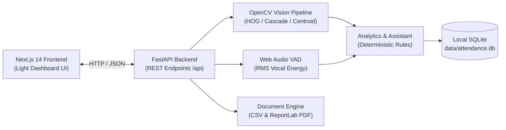

# Multimodal Attendance & Engagement Agent

A full-stack, privacy-preserving, offline-first classroom intelligence agent designed for educational institutions, colleges, classrooms, and professional training environments.

The agent records sustained participant attendance from live camera feeds, uploaded videos, or deterministic simulated classroom streams, extracts non-invasive physical and vocal activity proxies, computes transparent explainable engagement metrics, and delivers evidence-based teaching suggestions—**operating 100% locally without external cloud dependencies or API keys**.

---

## Key Features

1. **Automated Attendance Register:**
   - Detects visible participants and tracks anonymous IDs across consecutive frames.
   - Requires sustained presence observation ($\ge 30$ seconds) before verifying attendance.
   - Categorizes statuses: `Present`, `Late`, `Left early`, `Unverified`, `Manually confirmed`, `Absent`.
   - Supports manual teacher corrections with permanent audit logging.

2. **Multimodal Activity Indicators:**
   - **Video Modality:** Person detection, upper-body presence, movement frequency via frame differencing, and head orientation indicators.
   - **Audio Modality:** Web Audio RMS energy and voice-activity ratio tracking.
   - **Missing Modality Handling:** Renormalizes weights over active signals; never assigns zero or penalizes missing sensors.

3. **Explainable Engagement Score (0–100):**
   - Deterministic fusion over available indicators (Participation: 35%, Movement: 25%, Head Orientation: 20%, Audio: 20%).
   - Transparent contribution breakdowns and confidence scores.
   - **Ethical Safeguard:** Low movement is *never* equated to disengagement (accommodates quiet writing, reading, and attentive listening).

4. **Deterministic AI Teaching Assistant:**
   - Generates evidence-based pedagogical recommendations without internet access or LLMs.
   - Detects continuous monologue intervals, participation declines, and pacing review points.
   - Interactive teacher actions: *Accept*, *Dismiss*, *Mark Completed*.

5. **Document Generation & Reporting:**
   - Instant export of official session records to **CSV** and **PDF** formats.
   - Transparent methodology disclaimers and audit trail summaries embedded in all reports.

6. **Privacy & Offline-First Guarantees:**
   - Local SQLite database with zero third-party telemetry or cloud network calls.
   - Automatic media retention policies and one-click data purge workflows.
   - Explicit consent tracking for student video presence and identity association.

---

## Technology Stack

- **Unified Full-Stack Framework:** Next.js 14 (App Router) running both the modern reactive UI and high-performance serverless Route Handlers on a single port (`http://localhost:3000`).
- **Language & Types:** 100% TypeScript with strict typing across UI and API endpoints.
- **Styling & UI:** Tailwind CSS, Lucide Icons, Recharts for data visualization, React Hook Form, and Zod.
- **Database & Persistence:** Embedded local SQLite database (`data/attendance.db`) using Node.js native `node:sqlite` (`DatabaseSync`), requiring zero C++ build tools, zero external daemons, and zero cloud API keys.
- **Offline Reports Engine:** Pure offline PDF generation via `pdfkit` and CSV exports directly from server endpoints.

---

## Quick Start (Single Command)

### Prerequisites

- Node.js 20+ (Node 22 or 24 recommended)
- npm 9+

### Running the Complete Application

```bash
# 1. Install dependencies
npm install

# 2. Start the unified full-stack application
npm run dev
```

Open your browser at **[http://localhost:3000](http://localhost:3000)**.
Both the complete interactive dashboard and all backend REST APIs are active immediately on port 3000. No separate server, Python virtualenv, or second terminal is needed.

## Architecture Overview



For the complete architectural design and database entity-relationship diagram, see:
- [Architecture Documentation](docs/ARCHITECTURE.md)
- [Database ERD](docs/DATABASE_ERD.md)
- [API Reference](docs/API_DOCUMENTATION.md)
- [Offline Setup Guide](docs/OFFLINE_SETUP.md)

---

## Quick Start & Installation

### 1. Prerequisites
- **Python 3.11+** installed (`python --version`)
- **Node.js v18+** installed (`node --version`)

### 2. Environment Setup

```bash
# 1. Clone or navigate to the repository
cd "c:\Users\HP\Desktop\skill bullet project two"

# 2. Setup Python Virtual Environment & Install Dependencies
python -m venv venv
.\venv\Scripts\pip install -r backend/requirements.txt

# 3. Setup Frontend Dependencies
cd frontend
npm install
npm run build
cd ..
```

### 3. Running the Application

You can start both backend and frontend using the Windows helper script:
```powershell
.\scripts\run_all.bat
```

Or run each service individually in separate terminals:

**Terminal 1 (Backend Server):**
```powershell
.\venv\Scripts\python.exe -m uvicorn backend.app.main:app --host 0.0.0.0 --port 8000 --reload
```

**Terminal 2 (Frontend Client):**
```powershell
cd frontend
npm run dev
```

### 4. Local Access Points
- **Frontend Dashboard:** [http://localhost:3000](http://localhost:3000)
- **FastAPI OpenAPI Interactive Docs:** [http://localhost:8000/api/docs](http://localhost:8000/api/docs)
- **System Health Status:** [http://localhost:8000/api/health](http://localhost:8000/api/health)

---

## Demonstration Workflow (Demo Mode)

The application includes a self-contained demonstration workflow that functions immediately without requiring external media files or cameras:

1. Open [http://localhost:3000](http://localhost:3000).
2. Click **"Load Demo Data"** in the top navigation bar. This seeds 14 students, 2 sample courses (`CS-101`, `DATA-204`), 3 historical sessions, and 5-minute interval metrics.
3. Navigate to **"Live Session"** in the sidebar.
4. Select **"Simulated Classroom Session"**, review the privacy checklist, and click **"Start Session"**.
5. Watch the real-time simulation progress: live duration ticker, participant presence threshold tracking ($\ge 30$ seconds), and real-time metric gauges.
6. Test controls: **Pause**, **Resume**, **Stop**, and **Finalize & Save**.
7. Navigate to **"Attendance"** to view the live register and test the teacher manual correction modal.
8. Navigate to **"Engagement Analytics"** to inspect Recharts timelines, test the configurable weight sliders, and review neutral interval insights.
9. Navigate to **"AI Teaching Assistant"** to review pedagogical suggestions with supporting evidence and change their status.
10. Navigate to **"Reports"** to download official CSV and PDF session summaries.

---

## Running Automated Tests

A comprehensive Pytest suite verifies health checks, database seeding, course/student APIs, weight renormalization, neutral insight phrasing, recommendation engine logic, and PDF/CSV generation:

```powershell
.\venv\Scripts\python.exe -m pytest backend/tests/test_api.py -v
```

Expected output:
```text
backend/tests/test_api.py::test_health_capabilities PASSED
backend/tests/test_api.py::test_seed_demo_data PASSED
backend/tests/test_api.py::test_get_courses_and_students PASSED
backend/tests/test_api.py::test_analytics_overview PASSED
backend/tests/test_api.py::test_explainable_engagement_score_logic PASSED
backend/tests/test_api.py::test_neutral_insight_detection PASSED
backend/tests/test_api.py::test_recommendation_engine PASSED
backend/tests/test_api.py::test_csv_and_pdf_report_generation PASSED
======================= 8 passed in ~4.5s =======================
```

---

## Troubleshooting & FAQ

- **Backend fails to connect from browser:**
  Ensure the backend is running on `http://localhost:8000`. Check that `NEXT_PUBLIC_API_URL` is set to `http://localhost:8000/api` in `frontend/.env.local` if modified.
- **Camera access denied in Live Session:**
  If the browser denies webcam access or no camera is plugged in, the live session UI displays an informative alert and provides a one-click button to switch to *Simulated Classroom Session* or *Uploaded Video* mode.
- **How to reset the database:**
  Click **"Reset Data"** in the dashboard overview or run `.\venv\Scripts\python.exe scripts/seed_demo.py`.
- **Where are files stored:**
  - Database: `data/attendance.db`
  - Uploaded videos: `data/uploads/`
  - Generated reports: `data/reports/`

---

## License & Privacy Statement

This software is developed for ethical, non-punitive classroom dynamics research. It does not perform emotion recognition, psychological inference, or automated disciplinary labeling. All processing remains strictly on the institution's local hardware.

