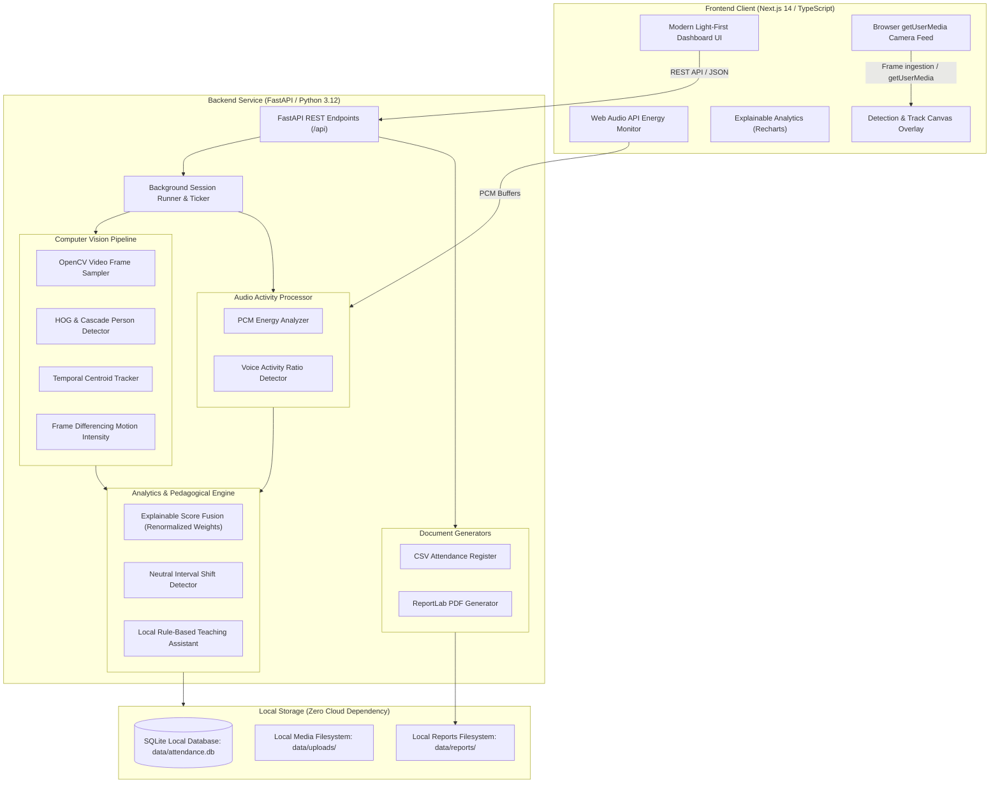

# System Architecture: Multimodal Attendance & Engagement Agent

## 1. High-Level Architectural Diagram

## 2. Multimodal Data Pipeline

### Video Processing Pipeline
1. **Frame Sampling:** Frames are decoded locally from webcam streams or uploaded video files at a configurable interval (0.5 to 2.0 FPS).
2. **Person & Face Detection:** Utilizes OpenCV's Default People HOG Descriptor combined with Haar cascade fallbacks to detect visible persons without requiring heavy GPU or cloud neural network dependencies.
3. **Anonymous Centroid Tracking:** Detections are assigned persistent anonymous track IDs (`track-01`, `track-02`, etc.) across consecutive frames using Euclidean distance centroid matching.
4. **Sustained Presence Verification:** A participant is marked as `Present` only after their observed duration meets a configurable threshold (e.g. $\ge 30$ seconds). Brief occlusions (up to 15 frames) are bridged before retiring a track.
5. **Physical Movement Intensity:** Optical frame differencing with Gaussian smoothing calculates overall classroom movement intensity ($0-100\%$).

### Audio Processing Pipeline
1. **Vocal Activity Ratio:** Analyzes raw 16-bit mono PCM chunks to compute root-mean-square (RMS) energy.
2. **Missing Modality Handling:** When audio input is unavailable or disabled, the system explicitly reports the modality as inactive and renormalizes visual metrics without assigning a penalizing zero.

### Explainable Fusion & Pedagogical Assistant
1. **Weight Renormalization:** Configurable initial weights (Participation: 35%, Movement: 25%, Head Orientation: 20%, Audio: 20%) are normalized strictly over active signals.
2. **Neutral Insight Language:** Time window shifts are phrased objectively (e.g., *"Participation activity decreased during this interval"*)—never subjective or judgmental assertions like *"Students stopped paying attention"*.
3. **Deterministic Rules-Based Teaching Assistant:** Recommends peer discussions, pacing pauses, or concept check-ins based purely on statistical dynamics without requiring external LLM APIs.

