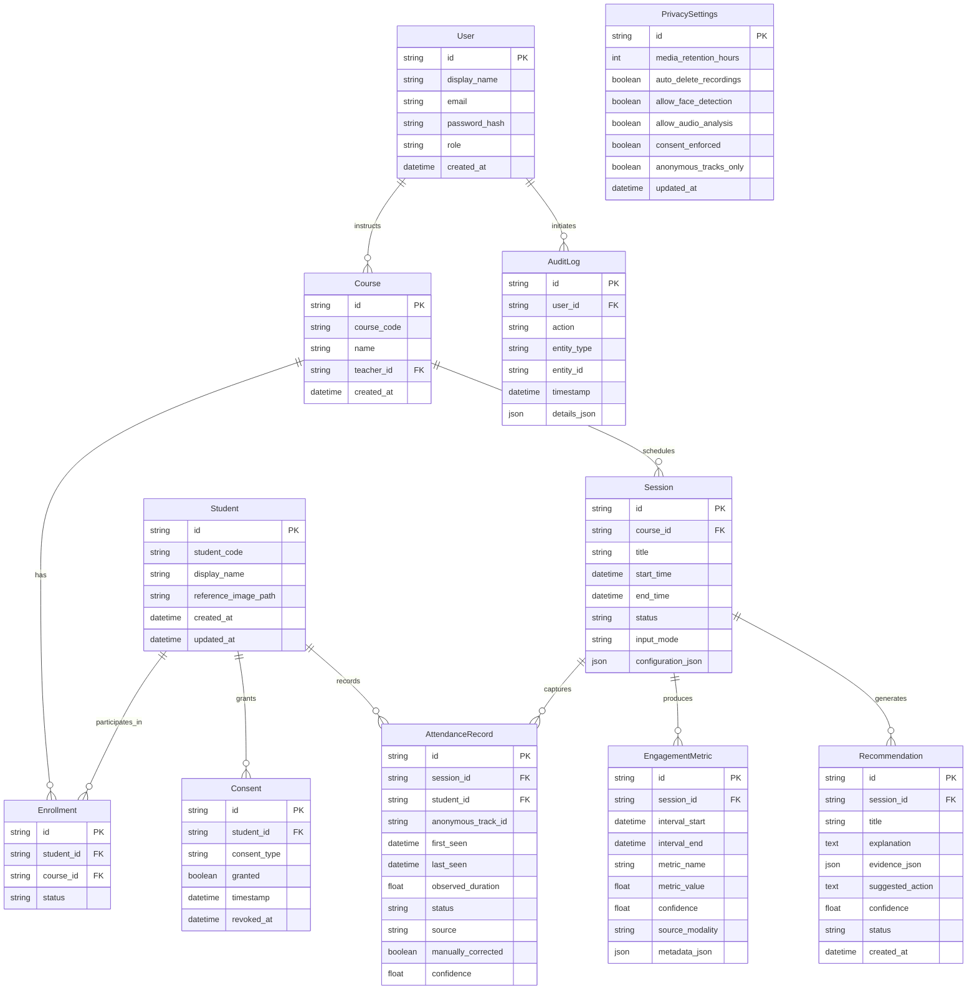

# Database Entity-Relationship Diagram (ERD)

The database is built on SQLAlchemy and stored in local SQLite (`data/attendance.db`) with foreign key enforcement and cascading deletion policies. The schema is fully compatible with migration to PostgreSQL.

